# LifePass Mint Tutorial (WeGene)

> This tutorial is only for LifePass minting. For genetic testing kit and WeGene® genetic testing tutorials, please follow the instructions in the kit you received. You can also visit WeGene®'s official WeChat account, select Service -> Bind Collection Tube from the bottom menu, and follow the guidance.
>
>
> *If you have already sent out the collection tube, please wait patiently for WeGene®'s notification regarding the testing status. Once completed, you can mint your LifePass through this tutorial.*
>

<aside>
💡

WeGene® only provides core data related services for LifePass. WeGene® is committed to promoting global population genomics research and application, and is a leading genomics team in the country.

</aside>

Dear users, after receiving notification from WeGene®, please visit WeGene's official website https://www.wegene.com/en and log in using the email address you submitted when binding the collection tube.

Then please follow the steps below:

1. Click "**Profile**" in the upper right corner of the webpage to enter the following page. Then select "**Download Core Data**".

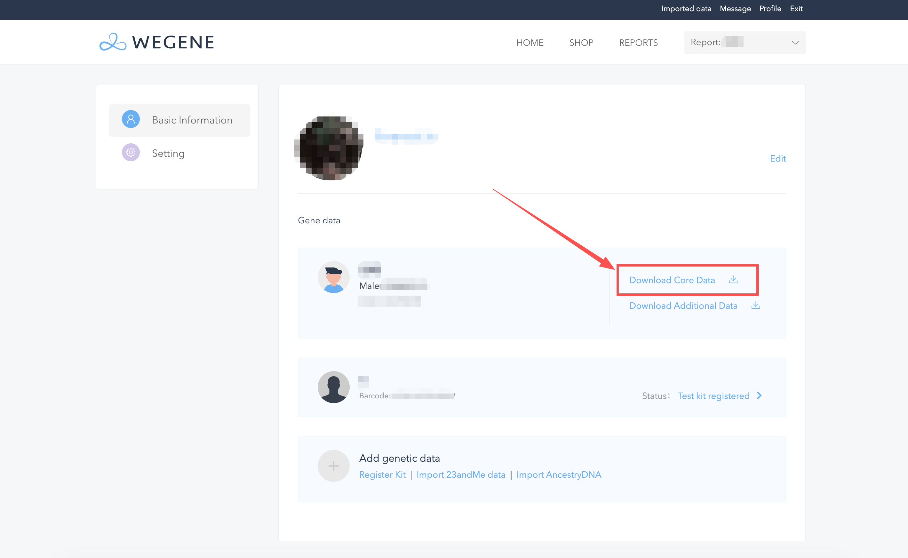

2. For the security of your personal information, we will verify your information before downloading.

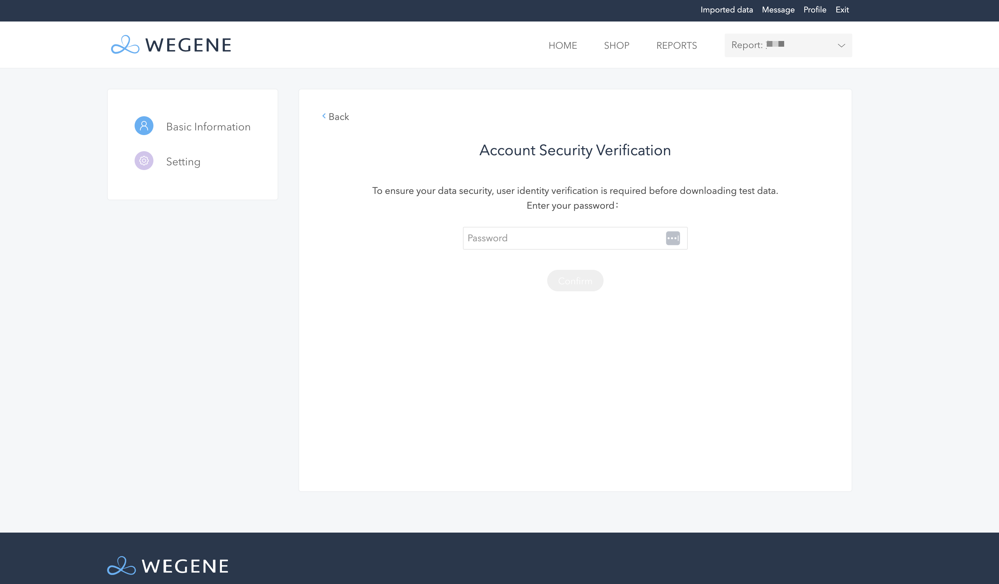

3. Select your preferred **verification method**, obtain the verification code, then enter the verification code and click **Confirm**. The download will start automatically. The core data may be large, so you need to wait patiently.

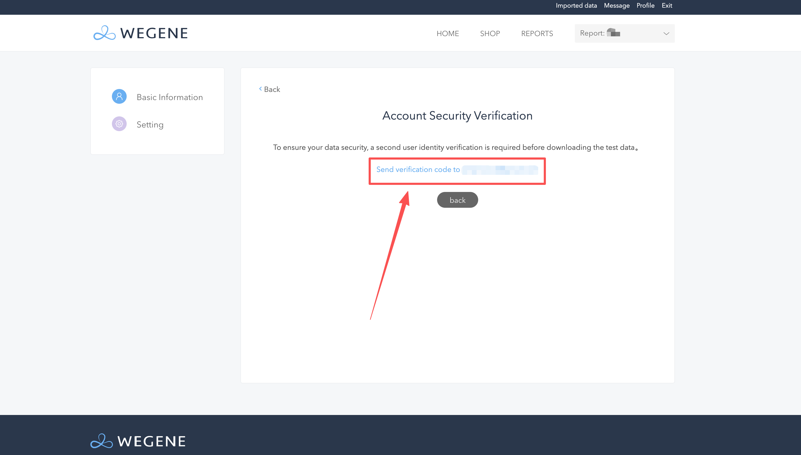

4. After the core data download is successful, you can leave the page. Then find the **.txt file** named after you in your download directory, which is your core data.

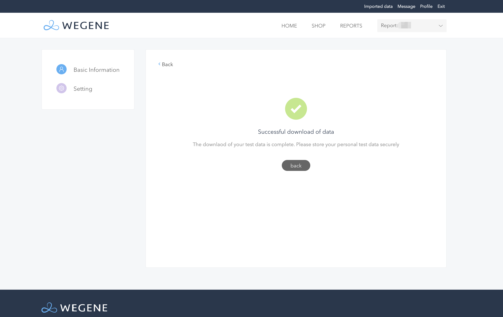

5. After obtaining your core data file, please visit [here](https://pass.dlife.xyz/), then click **Mint LifePass** to start the LifePass minting process.

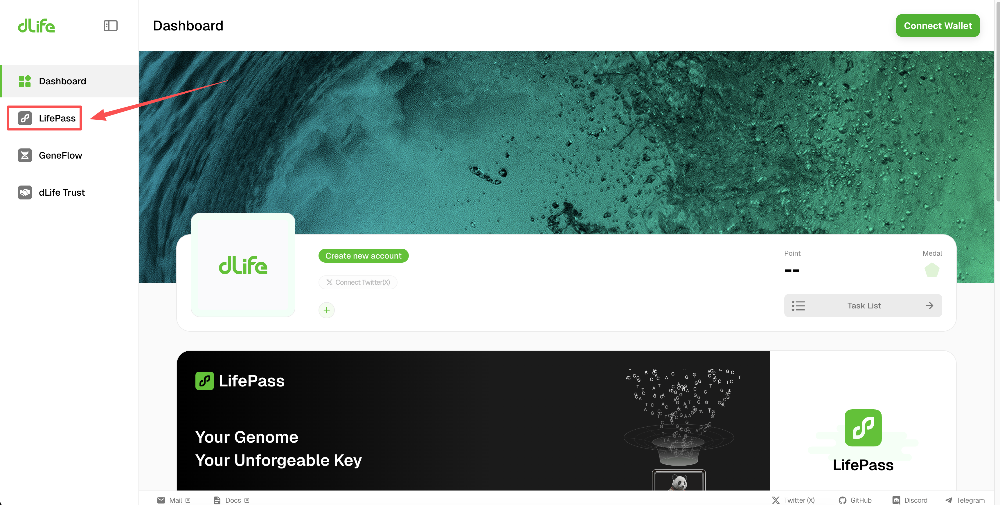

6. LifePass NFT is now deployed on **BNB Smart Chain (BSC Mainnet)**. You need to connect your wallet to mint your LifePass.

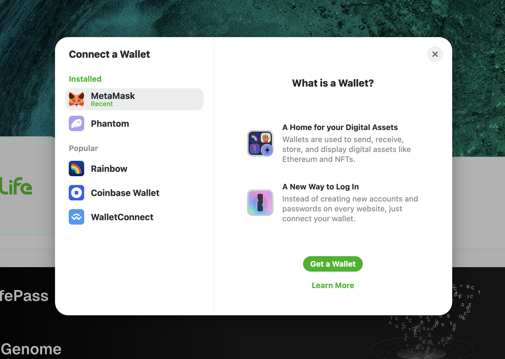

7. After connecting your wallet, please ensure you have selected **BNB Smart Chain** network, then click **Mint LifePass** to enter the minting page.

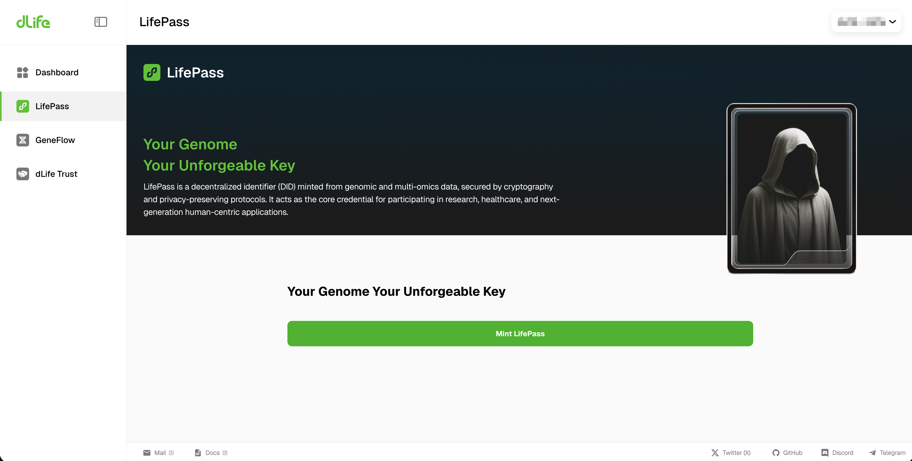

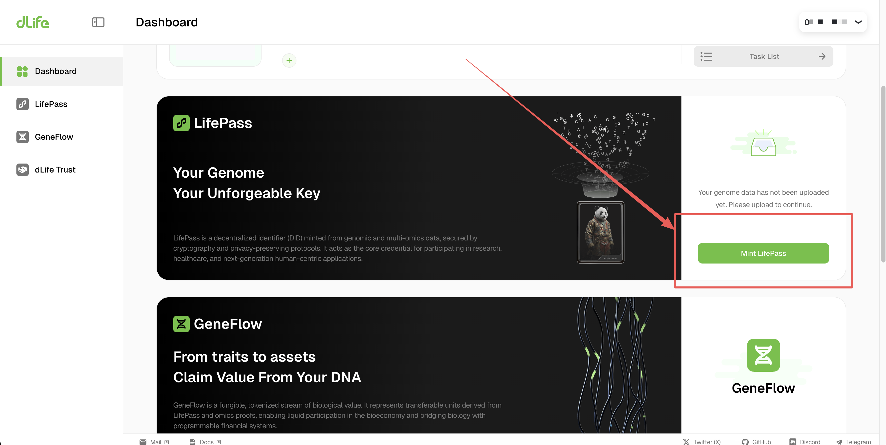

8. Now, you can upload the DNA data you downloaded earlier to mint your first on-chain DID based on **biological** **information**! To experience our ecosystem earlier, you can also mint an incomplete version of LifePass before receiving the core data to explore our product. **Please note that only the complete version of LifePass can enjoy all the benefits**.

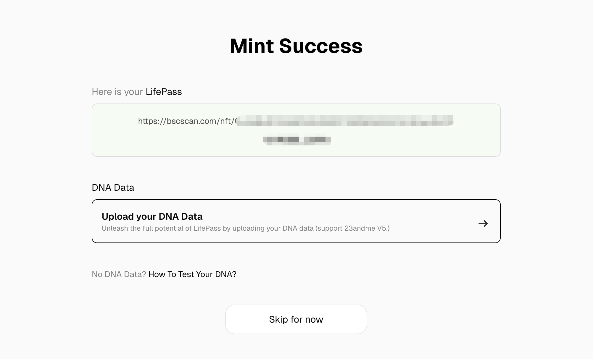

9. Before formally uploading data, please check to agree to our relevant policies and regulations, then select the data provider and upload the **.txt file** you downloaded earlier.

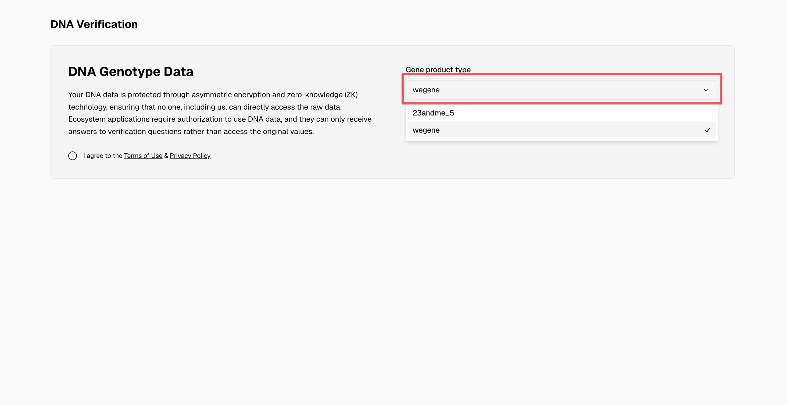

10. Your core data will then be uploaded, it takes 3 minutes normally, we suggest you to stay on the page till the data has been uploaded.

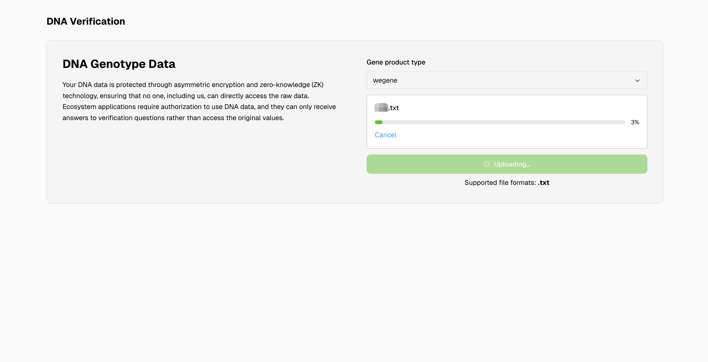

11. After the data is successfully uploaded, we need to encrypt and process the core data. Please wait patiently. You can also leave for about 30 minutes and come back to check, as the data will not be lost. Once processing is complete, you can view your LifePass on this page!

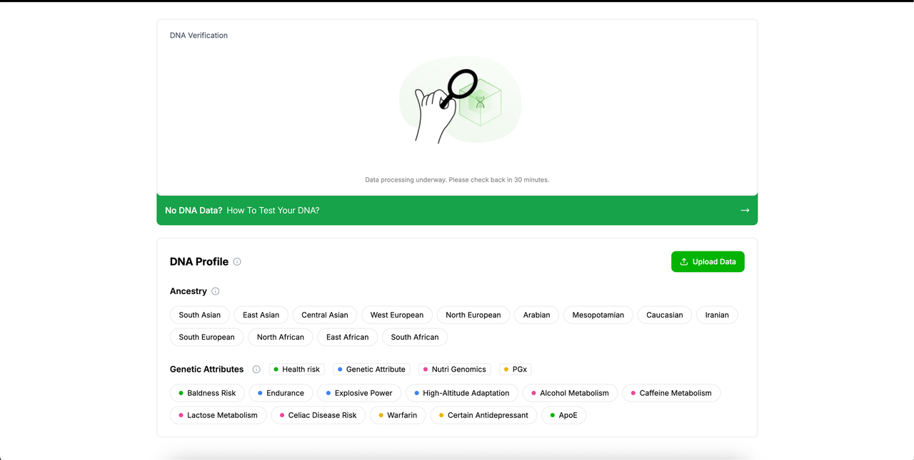
